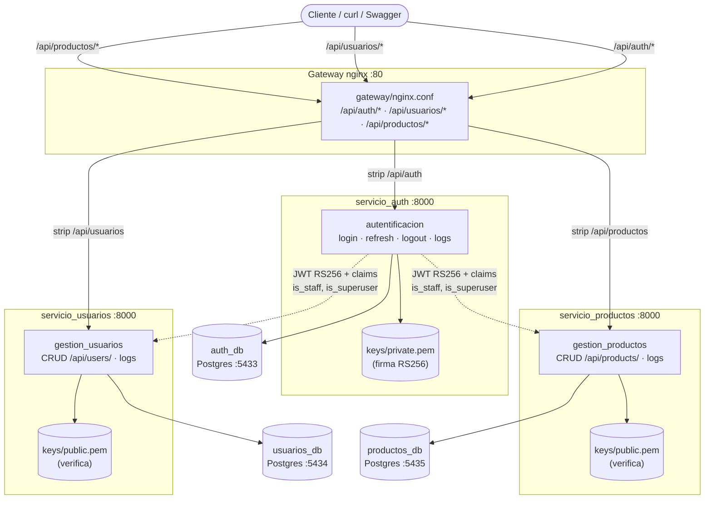

# Practica 4 para TSCC — Microservicios Django + JWT

## Debido a ciertas complicaciones con el documento proporcionado, el uso de IA fue gran parte para hacer los fix

## Tambien fue util para generar el README junto al diagrama mermaid

## Arquitectura

El monolito original (`proyecto_django/back_end_django/` con las apps
`autentificacion`, `gestion_usuarios` y `gestion_productos`) se separó en
3 microservicios Django independientes, cada uno con su propia base de
datos PostgreSQL:

| Servicio           | Carpeta                                              | Puerto host | BD (puerto host)    | Responsabilidad                                                              |
| ------------------ | ---------------------------------------------------- | ----------- | ------------------- | ---------------------------------------------------------------------------- |
| gateway (nginx)    | `proyecto_django/back_end_django/gateway/nginx.conf` | 80          | —                   | Punto único de entrada: `/api/auth/*`, `/api/usuarios/*`, `/api/productos/*` |
| servicio_auth      | `proyecto_django/back_end_django/servicio_auth`      | — (interno) | auth_db (5433)      | Emite JWT (RS256), refresh, logout, logs                                     |
| servicio_usuarios  | `.../servicio_usuarios`                              | — (interno) | usuarios_db (5434)  | CRUD de usuarios                                                             |
| servicio_productos | `.../servicio_productos`                             | — (interno) | productos_db (5435) | CRUD de productos                                                            |

> Los servicios Django NO publican puertos: solo el gateway expone el
> puerto 80, así nunca hay que cambiar de puerto para usar las APIs.
> (Para depurar un servicio directo, descomenta su bloque `ports` en el
> `docker-compose.yml`: 8001/8002/8003.)

Autenticación entre servicios: `servicio_auth` firma los tokens con la
llave privada `servicio_auth/keys/private.pem` (RS256) e incluye los
claims `username`, `email`, `is_staff`, `is_superuser`. Los demás
servicios solo poseen `keys/public.pem` y validan de forma stateless
(`JWTStatelessUserAuthentication` + permiso `IsStaffFromToken` para los
endpoints de logs). La llave privada y los `.env` nunca se commitean
(ver `.gitignore`); por eso un clon fresco debe generarlos (paso 2).

### Diagrama de arquitectura



## Guía desde cero (clon fresco)

### 0. Requisitos previos

- Git, Docker y Docker Compose (plugin `docker compose`)
- OpenSSL (para generar las llaves JWT)
- Opcional para correr tests en local: Python 3.14 + `uv`

Verifica con:

```bash
git --version
docker --version
docker compose version
openssl version
```

### 1. Clonar el repositorio

```bash
git clone <URL-del-repositorio>
cd practica4/proyecto_django/back_end_django
```

Todos los comandos siguientes se ejecutan desde
`proyecto_django/back_end_django` (donde está el `docker-compose.yml`
de microservicios).

### 2. Generar las llaves JWT (RS256) y los `.env`

En un clon fresco no existen `keys/private.pem` ni los archivos `.env`
(están ignorados por git), así que hay que crearlos:

```bash
# Llave privada (SOLO la posee servicio_auth) + llave pública
openssl genrsa -out servicio_auth/keys/private.pem 2048
openssl rsa -in servicio_auth/keys/private.pem -pubout -out servicio_auth/keys/public.pem
chmod 600 servicio_auth/keys/private.pem

# Repartir la llave PÚBLICA a los demás servicios (solo verifican firmas)
cp servicio_auth/keys/public.pem servicio_usuarios/keys/public.pem
cp servicio_auth/keys/public.pem servicio_productos/keys/public.pem

# Variables de entorno de cada servicio (valores de desarrollo por defecto)
cp servicio_auth/.env.example servicio_auth/.env
cp servicio_usuarios/.env.example servicio_usuarios/.env
cp servicio_productos/.env.example servicio_productos/.env
```

> Si los puertos 80 o 5433-5435 están ocupados, o quieres cambiar
> credenciales, edita los `.env` y el `docker-compose.yml` antes de seguir.

### 3. Construir y levantar los servicios

```bash
docker compose build
docker compose up -d
docker ps   # los 7 contenedores deben estar Up (gateway + 3 APIs + 3 Postgres)
```

Verifica que el gateway responde:

```bash
curl -s http://127.0.0.1/
# {"gateway":"ok","base":"/api","servicios":{"auth":"/api/auth/",...},...}
```

### 4. Aplicar migraciones (una BD por servicio)

Espera ~15 segundos a que los Postgres estén sanos y luego:

```bash
docker compose exec servicio_auth python manage.py migrate
docker compose exec servicio_usuarios python manage.py migrate
docker compose exec servicio_productos python manage.py migrate
```

### 5. Crear el usuario administrador (solo existe en servicio_auth)

```bash
docker compose exec servicio_auth python manage.py initadmin
```

Credenciales: usuario `Admin`, contraseña `AdminApiDjango123`.

### 6. Uso y prueba de la API

**Vía única: el gateway** (`http://127.0.0.1`, puerto 80, sin cambiar puertos).
Todas las peticiones —curl, Swagger o frontend— usan esta base URL:

| URL del gateway    | Destino            |
| ------------------ | ------------------ |
| `/api/auth/*`      | servicio_auth      |
| `/api/usuarios/*`  | servicio_usuarios  |
| `/api/productos/*` | servicio_productos |

El prefijo se elimina al reenviar: `/api/usuarios/api/users/` llega como
`/api/users/` al servicio. Cada Django genera sus URLs con el prefijo
(`FORCE_SCRIPT_NAME`), por eso el Swagger funciona detrás del gateway,
incluido el "Try it out". Cada servicio conserva además sus logs
propios: `/api/auth/api/logs/...`, `/api/usuarios/api/logs/...`,
`/api/productos/api/logs/...`.

(Las rutas antiguas `/auth/*`, `/usuarios/*`, `/productos/*` redirigen
301 a su equivalente `/api/...` por compatibilidad.)

#### 6.1 Autenticación (servicio_auth)

**a) Login — obtener el token:**

```bash
curl -s -X POST http://127.0.0.1/api/auth/api/auth/token/ \
  -H "Content-Type: application/json" \
  -d '{"username": "Admin", "password": "AdminApiDjango123"}'
# Responde {"refresh": "...", "access": "..."} — guarda ambos.
# El "access" dura 30 minutos; el "refresh" 1 día.
```

**b) Usar el token** en cualquier endpoint protegido:

```bash
export TOKEN="<pega-aqui-el-access-token>"
curl -s http://127.0.0.1/api/usuarios/api/users/ \
  -H "Authorization: Bearer $TOKEN"
```

**c) Renovar el access cuando expire:**

```bash
curl -s -X POST http://127.0.0.1/api/auth/api/auth/token/refresh/ \
  -H "Content-Type: application/json" \
  -d "{\"refresh\": \"$REFRESH\"}"
# Devuelve un "access" nuevo. El refresh usado puede quedar invalidado
# (reusarlo responde 400), así que guarda el nuevo par si rota.
```

**d) Logout (requiere Bearer + refresh vigente):**

```bash
export REFRESH="<pega-aqui-el-refresh-token>"
curl -s -X POST http://127.0.0.1/api/auth/api/auth/logout/ \
  -H "Content-Type: application/json" \
  -H "Authorization: Bearer $TOKEN" \
  -d "{\"refresh\": \"$REFRESH\"}"
# {"mensaje": "Sesión cerrada correctamente."}
```

#### 6.2 Usuarios (servicio_usuarios, requiere Bearer)

```bash
# Listar usuarios
curl -s http://127.0.0.1/api/usuarios/api/users/ \
  -H "Authorization: Bearer $TOKEN"

# Ver un usuario (reemplaza <id>)
curl -s http://127.0.0.1/api/usuarios/api/users/<id>/ \
  -H "Authorization: Bearer $TOKEN"

# Crear un usuario (password es OBLIGATORIO; sin él responde 500)
curl -s -X POST http://127.0.0.1/api/usuarios/api/users/ \
  -H "Content-Type: application/json" \
  -H "Authorization: Bearer $TOKEN" \
  -d '{"username": "juan", "email": "juan@test.com", "password": "JuanPass123",
       "first_name": "Juan", "last_name": "Perez", "date_of_birth": "1990-01-01"}'
# 201 + el usuario creado (sin el password)

# Actualizar parcial
curl -s -X PATCH http://127.0.0.1/api/usuarios/api/users/<id>/ \
  -H "Content-Type: application/json" \
  -H "Authorization: Bearer $TOKEN" \
  -d '{"first_name": "Juan Carlos"}'

# Eliminar
curl -s -X DELETE http://127.0.0.1/api/usuarios/api/users/<id>/ \
  -H "Authorization: Bearer $TOKEN"
```

#### 6.3 Productos (servicio_productos, requiere Bearer)

```bash
# Listar productos
curl -s http://127.0.0.1/api/productos/api/products/ \
  -H "Authorization: Bearer $TOKEN"

# Ver un producto (reemplaza <id>)
curl -s http://127.0.0.1/api/productos/api/products/<id>/ \
  -H "Authorization: Bearer $TOKEN"

# Crear un producto
curl -s -X POST http://127.0.0.1/api/productos/api/products/ \
  -H "Content-Type: application/json" \
  -H "Authorization: Bearer $TOKEN" \
  -d '{"type": "BIEN", "name": "Laptop", "price": "1500.00", "status": true,
       "description": "Laptop de prueba", "product_key": "LAP00001",
       "image_link": "http://example.com/img.png"}'
# 201 + el producto creado

# Actualizar parcial
curl -s -X PATCH http://127.0.0.1/api/productos/api/products/<id>/ \
  -H "Content-Type: application/json" \
  -H "Authorization: Bearer $TOKEN" \
  -d '{"price": "1400.00"}'

# Eliminar
curl -s -X DELETE http://127.0.0.1/api/productos/api/products/<id>/ \
  -H "Authorization: Bearer $TOKEN"
```

#### 6.4 Logs de auditoría (solo admin / `is_staff`)

```bash
curl -s "http://127.0.0.1/api/auth/api/logs/auditoria/?limite=5" \
  -H "Authorization: Bearer $TOKEN"
```

También disponibles `.../api/logs/tecnico/` y los equivalentes de
usuarios (`/api/usuarios/api/logs/...`) y productos
(`/api/productos/api/logs/...`).

#### 6.5 Probar desde Swagger

Documentación (vía gateway, punto único de entrada):

```
http://127.0.0.1/api/auth/swagger/       # auth
http://127.0.0.1/api/usuarios/swagger/   # usuarios
http://127.0.0.1/api/productos/swagger/  # productos
```

Pulsa `Authorize` e ingresa `Bearer <access-token>` (con un espacio
entre `Bearer` y el token); luego el "Try it out" de cada endpoint ya
envía el token automáticamente.

#### 6.6 Códigos de respuesta esperados

| Código | Cuándo lo verás                                                               |
| ------ | ----------------------------------------------------------------------------- |
| 200    | GET, PATCH, refresh, logout, DELETE                                           |
| 201    | POST de usuario/producto creado                                               |
| 400    | Campos inválidos; refresh reusado o expirado (`Token inválido o ya expirado`) |
| 401    | Sin header `Authorization`, token expirado o falso                            |
| 403    | Usuario sin `is_staff` en `/api/logs/*`                                       |
| 404    | Ruta o `id` inexistente                                                       |
| 500    | `POST /api/users/` sin `password` (pendiente de validar como 400)             |

Sin token (o con uno falso) los servicios responden `401`; un usuario
sin `is_staff` recibe `403` en `/api/logs/*`.

### 7. Correr los tests (opcional, sin Docker)

```bash
cd practica4
uv sync   # instala dependencias, incluye cryptography para RS256

DATABASE_ENGINE=django.db.backends.sqlite3 DATABASE_NAME=/tmp/test_auth.db \
  uv run --project . python proyecto_django/back_end_django/servicio_auth/manage.py test
```

O por servicio, desde su carpeta (requiere el `.venv` activado o `uv run`):

```bash
cd proyecto_django/back_end_django/servicio_auth
DATABASE_ENGINE=django.db.backends.sqlite3 DATABASE_NAME=/tmp/t1.db python manage.py test
cd ../servicio_usuarios
DATABASE_ENGINE=django.db.backends.sqlite3 DATABASE_NAME=/tmp/t2.db python manage.py test
cd ../servicio_productos
DATABASE_ENGINE=django.db.backends.sqlite3 DATABASE_NAME=/tmp/t3.db python manage.py test
```

> Los tests de usuarios/productos simulan el JWT con `force_authenticate`
> (el login real vive en servicio_auth); los de auth validan además los
> claims `is_staff`/`is_superuser` y el algoritmo RS256.

### 8. Comandos útiles

```bash
docker compose logs -f gateway              # ver el tráfico del gateway
docker compose logs -f servicio_auth       # ver logs de un servicio
docker compose logs -f servicio_usuarios
docker compose logs -f servicio_productos
docker compose down                        # detener todo (conserva datos)
docker compose down -v                     # detener y BORRAR las BDs
```

Si los logs dan error de permisos en local:

```bash
sudo chown -R $USER:$USER proyecto_django/back_end_django/servicio_*/logs
chmod -R u+rwX proyecto_django/back_end_django/servicio_*/logs
```

## Problemas frecuentes

| Síntoma                                               | Causa probable                                             | Solución                                                                     |
| ----------------------------------------------------- | ---------------------------------------------------------- | ---------------------------------------------------------------------------- |
| `env file ... not found` al hacer `up`                | Falta el paso 2 (`.env`)                                   | Crea los 3 `.env` desde sus `.env.example`                                   |
| `401` en usuarios/productos con token recién obtenido | Llave pública desactualizada o token expirado (30 min)     | Repite el `cp` de `public.pem`, pide un token nuevo                          |
| `Could not deserialize key data`                      | `keys/*.pem` vacíos o corruptos                            | Regenera el par con el paso 2                                                |
| `connection refused` en `migrate`                     | Postgres aún iniciando                                     | Espera y reintenta                                                           |
| Puertos ocupados                                      | Otro proceso usa 80/5433-5435                              | Libera los puertos o edita el compose                                        |
| `502 Bad Gateway` en el puerto 80                     | Algún servicio Django aún está iniciando                   | Espera y reintenta; revisa `docker compose ps`                               |
| `500` al crear usuario (`missing password`)           | Falta el campo `password` en el POST                       | Incluye siempre `password` (ver 6.2)                                         |
| Swagger "try it out" falla vía gateway                | `FORCE_SCRIPT_NAME` no coincide con el prefijo del gateway | Verifica `FORCE_SCRIPT_NAME=/api/<servicio>` en compose/`.env` y `reverse()` |
